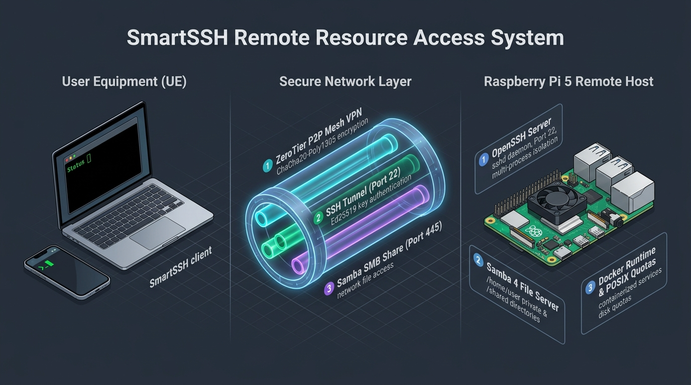

# SmartSSH

**Thesis Title (PL):** *Implementacja systemu zdalnego dostępu do zasobów na platformie Raspberry Pi*  
**Thesis Title (EN):** *Implementation of Remote Resource Access System on Raspberry Pi Platform*  

Cross-platform C++20 client application for secure remote file resource access, Samba network storage management, POSIX disk quota monitoring, and ZeroTier P2P VPN encrypted connectivity on Raspberry Pi host servers.



---

## 🛠️ How to Build

### Prerequisites
- **CMake** (v3.20 or newer)
- **C++20 Compiler**:
  - **Windows**: Visual Studio 2022 (MSVC / ClangCL)
  - **Linux**: GCC or Clang (`clang++`)
  - **macOS**: Apple Clang (`clang++`)

---

### Windows Build Instructions

#### Option A: PowerShell
```powershell
cmake -B build -S . -DCMAKE_BUILD_TYPE=Release ; cmake --build build --config Release
```

#### Option B: Command Prompt (cmd.exe)
```cmd
cmake -B build -S . -DCMAKE_BUILD_TYPE=Release && cmake --build build --config Release
```

---

### Linux & macOS Build Instructions

```bash
cmake -B build -S . -DCMAKE_BUILD_TYPE=Release
cmake --build build --config Release
```

*(Optional) Strip debug symbols on Linux/macOS:*
```bash
strip build/out/smart-ssh
```

---

## 📦 Executable Locations

After building, binaries are located in the `build/out/` directory:

- **Main Application**:
  - Windows: `build\out\Release\smart-ssh.exe` (or `build\out\smart-ssh.exe`)
  - Linux / macOS: `build/out/smart-ssh`
- **GoogleTest Suite (31 Tests)**:
  - Windows: `build\out\smart-ssh-tests.exe`
  - Linux / macOS: `build/out/smart-ssh-tests`

---

## 🧪 Running Unit & Regression Tests

To run the automated 31-test GoogleTest suite:

```powershell
# Windows
.\build\out\smart-ssh-tests.exe

# Linux / macOS
./build/out/smart-ssh-tests
```
